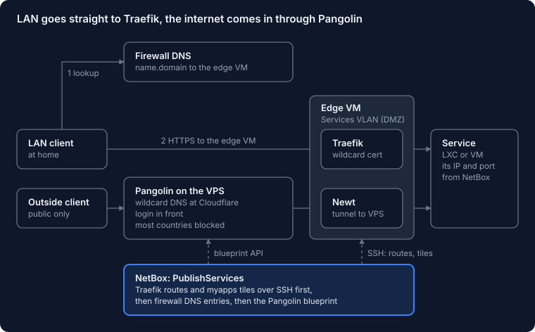
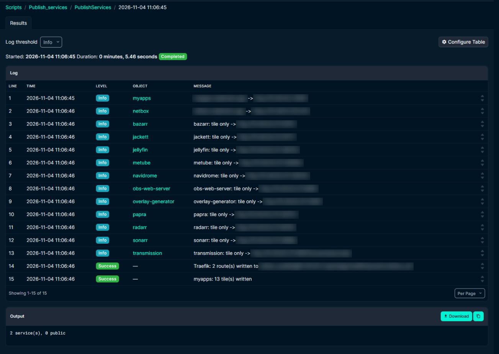
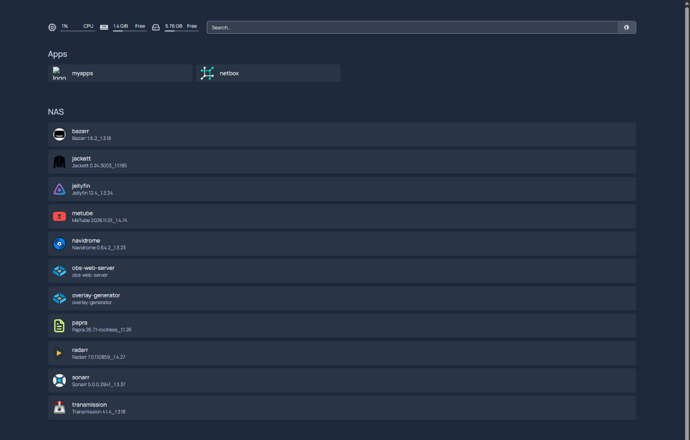
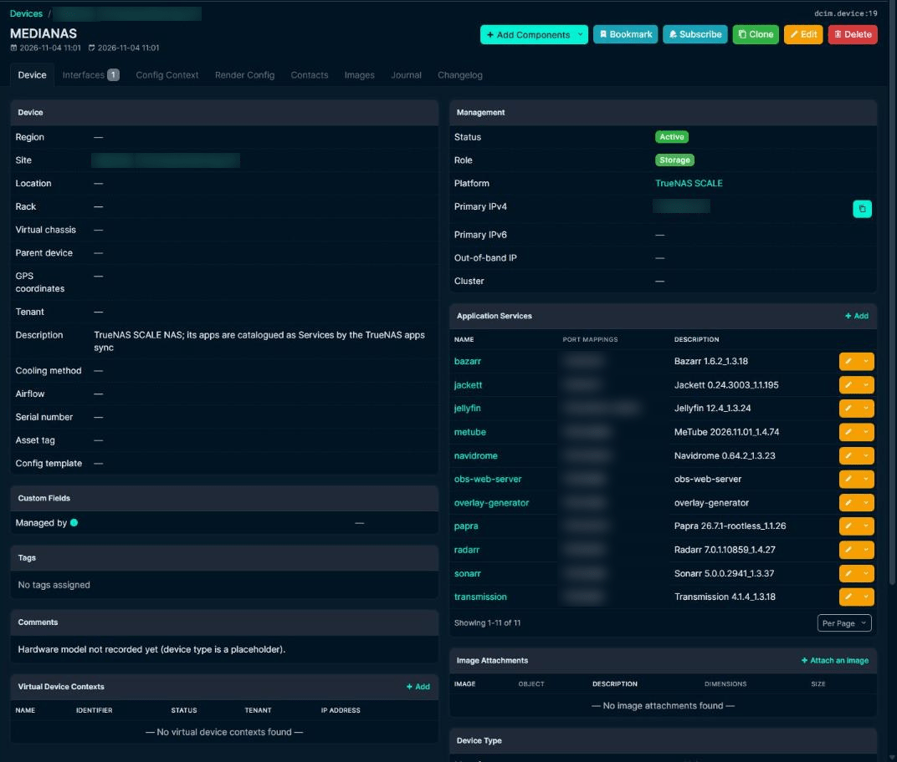
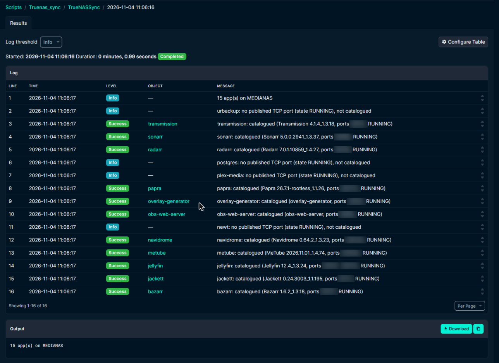

A few days ago I wrote about [rebuilding my lost UniFi controller](/posts/rebuild-lost-unifi-controller-netbox/) and ending up with NetBox as the source of truth for my whole lab. That post ended with switches and VLANs. This one is about what happened next, because once NetBox knows every VM, every IP and every port, it seems a shame to only use it for switches.

What bugged me was the routine around every new app. I'd spin up a container, then add a DNS record on the firewall, then a reverse proxy route, then a bookmark, then forget one of the three. So the new goal was simple: create the container, add one Service in NetBox, run a script, open `https://<name>.<my domain>` with a valid certificate. Nothing else by hand.

> **The short version:** NetBox Services are the list of what should be reachable. A publish script turns each one into a Traefik route on a small edge VM (with one wildcard certificate), a DNS entry on the firewall pointing at that VM plus a tile on a [Homepage](https://gethomepage.dev/) dashboard. It writes the route first and DNS second, keeps a state file so deleted Services get cleaned up. It reaches the edge VM over SSH with a key that can only run one receive script. The two things that cost me the most time: a Traefik router with its own `tls` block ignores the entrypoint's TLS defaults (hello, `TRAEFIK DEFAULT CERT`); an SSH key without a forced command happily treats your data as a shell command.
{: .prompt-tip }

## First, NetBox had to move house

Before NetBox could publish anything, it needed a better home. My first idea was to drop it in the new Services VLAN with all the other apps. Then I thought about what NetBox actually holds now: API credentials for the firewall, the UniFi controller and Proxmox, plus the ability to push config to switches. That's not an app, that's a box with keys to the whole network. It went into the management VLAN instead. Its web interface still gets published through Traefik like everything else.

Moving it was the usual list of small things that each break something if you forget them. A new IP in Proxmox and inside the VM. The firewall's API allow-list, because otherwise the Sophos sync gets refused. And a firewall rule from NetBox to the edge VM on SSH, which I only added after my first publish run sat there waiting on SSH until it gave up.

Then NetBox answered every request through Traefik with `Bad Request (400)`, even with `ALLOWED_HOSTS = ['*']`. That one took a while. Traefik adds an `X-Forwarded-Host` header, then Apache on the NetBox VM adds another one. Django doesn't like getting two. Unsetting the header early in the Apache vhost and adding the public URL to `CSRF_TRUSTED_ORIGINS` in `configuration.py` sorted it.

```apache
# early in the *:443 vhost
RequestHeader unset X-Forwarded-Host
```

```python
# configuration.py
CSRF_TRUSTED_ORIGINS = ['https://netbox.example.com']
```

I also moved the scripts' settings files out of `/opt/netbox` and into `/etc/netbox-sync/`. `/opt/netbox` belongs to root and the community updater is allowed to replace it, which is not where you want files your scripts depend on.

## The design: one name, two ways in

Every published service gets a name under my own domain. How you reach it depends on where you're standing.

**Inside the house (the default).** The firewall answers `<name>.<domain>` with the address of the edge VM. Traefik on that VM holds one wildcard certificate for the whole domain and forwards to the service's own IP and port. No service needs a certificate of its own.

**From outside (opt-in).** A service marked public also becomes a resource on [Pangolin](https://github.com/fosrl/pangolin), running on a small VPS. Cloudflare has a single wildcard record pointing at that VPS, so there's no public DNS record per service and nobody can read my service names off a DNS listing. Newt, Pangolin's tunnel client, runs on the edge VM and carries the traffic back into the lab, with a login in front and most of the world blocked outright.

Because the firewall's answer wins inside the house, even a public service never takes the detour out to the VPS and back when I'm at home.

{: w="760" h="472" }

The internal half is what runs today. The public half is built into the script, but the Pangolin site, API key and Cloudflare record are next on my list, so I'll tell you how that goes once it's live.

## A DMZ for the apps

The services and the edge VM live in a new VLAN, "Services", with its own zone on the firewall. My client VLAN can reach it on HTTP, HTTPS, SSH and ping. Nothing inside it can start a connection to the rest of the lab unless a rule says so. If one of those community-script containers ever turns out to be a bad idea, it's stuck in a room with only other apps for company.

NetBox has the VLAN, the prefix and an IP range reserved for new apps, so the next free address for a new container is one click away.

The edge VM is a small Debian VM rather than an LXC. Docker inside LXC has bitten me before with nesting and AppArmor; a VM that only runs a reverse proxy doesn't need to be clever. One compose file runs Traefik, Homepage and Newt. Traefik reads its routes from a folder of files, and that folder is the only thing NetBox ever writes to.

## How NetBox writes to the edge VM without root

This is the part I'm happiest with. The publish script connects over SSH as a user called `netbox-publish`. That user can do exactly one thing. Its key in `authorized_keys` has a forced command:

```text
restrict,command="/usr/local/bin/netbox-publish-receive" ssh-ed25519 AAAA... netbox-publish
```

Whatever the client asks for, SSH runs that receive script. The script accepts two words on its input: `routes` replaces the Traefik file, `homepage` replaces the dashboard's tile list. Anything else gets refused. Root login over SSH stays off. So even if someone got hold of that key, the worst they could do is publish a different list of routes, which is bad but a lot less bad than a shell.

How do I know it works? I asked it to run `id`. It refused. That's the test I'd do on any forced-command key: if `id` comes back with a user name, your key is a shell.

## What decides what gets published

Each Service in NetBox has a custom field called Exposure with four values: Internal, Public, Link only and None. Tagging a whole VM `public` makes all its services public, so one tag on the VM is enough for a box that only exists to be reached from outside.

The run order matters more than I expected:

1. Write the Traefik routes and check that worked.
2. Only then write the firewall DNS entries and the Pangolin resources.

That way a DNS name never points at Traefik before Traefik knows what to do with it. The script also keeps a state file of everything it created, so a Service I delete or set back to Internal gets cleaned up on the next run: DNS entry and route removed, Pangolin resource disabled. Disabled rather than deleted, because Pangolin's blueprint API doesn't document a delete. <!-- VERIFY: Pangolin blueprint API still has no documented delete -->

The plan is to run this from a NetBox event rule whenever a Service changes, plus every 15 minutes as a safety net. For now I still click Run.

{: w="1303" h="924" }
_Two real routes, eleven link-only tiles for the NAS apps, done in about five seconds._

## The certificate that wasn't mine

The first routes loaded. Every browser complained about the certificate. Looking closer, Traefik was serving `TRAEFIK DEFAULT CERT`, its own self-signed placeholder, even though the wildcard certificate was right there on the entrypoint.

The cause: I'd given each router its own `tls` block. A router with its own `tls` block doesn't inherit the TLS settings from the entrypoint. It starts from nothing. Once every generated router named the cert resolver and the wildcard domains itself, the real certificate showed up:

```yaml
http:
  routers:
    papra:
      rule: "Host(`papra.example.com`)"
      entryPoints: [websecure]
      service: papra
      tls:
        certResolver: letsencrypt
        domains:
          - main: "example.com"
            sans: ["*.example.com"]
  services:
    papra:
      loadBalancer:
        servers:
          - url: "http://192.0.2.10:8080"
```

The second Traefik surprise was smaller. With no services published yet, the script wrote an empty `routers:` map. Traefik rejects that with "routers cannot be a standalone element". An empty file now contains comments only.

> If Traefik serves `TRAEFIK DEFAULT CERT` while your wildcard certificate looks fine, check whether the router has its own `tls` block. If it does, it needs the `certResolver` and `domains` too.
{: .prompt-warning }

## myapps: a dashboard nobody has to maintain

With every service in NetBox anyway, a bookmark page was the obvious next step. I called it myapps, borrowed shamelessly from Microsoft's `myapps.microsoft.com`. It runs Homepage next to Traefik on the edge VM. It's also just a Service in NetBox, published like any other.

The same publish run that writes the Traefik routes also writes Homepage's `services.yaml`, over the same SSH key, using the `homepage` word. The title and theme in `settings.yaml` I still edit by hand, since that changes about once a year.

Every part of a tile comes from the Service in NetBox:

| Tile part | Taken from | Default |
|---|---|---|
| Section | Service field "Group" | Apps |
| Title | Service name | |
| Subtitle | Service description, prefixed "Public" when public | empty |
| Icon | Service field "Icon" (a Homepage icon name or a URL) | `<service name>.png` |
| Link | `https://<name>.<domain>`, or the Link URL for link-only services | |

Two Homepage details worth knowing. It refuses requests for host names it doesn't know, so the compose file sets `HOMEPAGE_ALLOWED_HOSTS` to the dashboard's own name. And tiles are only written when `MYAPPS=1` is set in the publish settings, so I could switch the feature on after the receive script was in place.

{: w="1372" h="874" }

The first run with tiles failed with this:

```text
sh: 1: routes: not found
```

The key on the edge VM still had no forced command. So SSH did what SSH does: it took the word `routes` my script sent and tried to run it as a shell command. Adding the `restrict,command=...` prefix fixed it. That's also why the `id` test above is now a habit.

## The NAS joins the party

My TrueNAS box was one device in NetBox, but the interesting part is the fifteen apps running on it, from Jellyfin to a document manager. A new script, TrueNAS apps sync, reads them from TrueNAS (read only) and keeps one NetBox Service per app on the NAS device.

The funny part was that NetBox already knew the NAS's IP address. The Sophos sync had found a DNS name for it on the firewall earlier, couldn't find a host to attach it to, and tagged it `verify`. So the IP had been sitting in IPAM as an orphan, waiting for someone to claim it. It now hangs on the NAS's network interface, DNS name and all.

Per app, the sync fills in:

- the app name plus the TCP host ports it publishes;
- the title and version from the TrueNAS catalogue as the description (custom Docker apps just get their name);
- the web portal link TrueNAS shows, with `0.0.0.0` swapped for the NAS's address;
- the catalogue icon, the Group "NAS" and a `truenas-app` tag;
- Exposure **Link only** when it's first created.

That last one is deliberate. A link-only tile on myapps points straight at the NAS's address and port: no DNS name, no Traefik route, above all no firewall hole from the DMZ to my NAS. If one app deserves its own proper name, I change its Exposure to Internal. The sync never overwrites Exposure, Group or Hostname once they exist, so my choices stick.

An app that disappears from TrueNAS keeps its Service but gets the `verify` tag and a journal entry. Same rule as the other syncs: nothing gets deleted behind my back.

Apps on the host network publish no port mapping, so for those the sync takes the port from their portal link instead. Plex and UrBackup report neither, so those two get added by hand.

{: w="1072" h="912" }

### NetBox 4.7 moved the ports

The first real run died with:

```text
property 'protocol' of 'Service' object has no setter
```

NetBox 4.7 changed how a Service stores its ports. Instead of a `protocol` and a `ports` list, there's now one `port_mappings` list with entries like `tcp/8080`. The old fields still read fine, which is why my other scripts never noticed, but you can't set them anymore. The sync writes `port_mappings` now. <!-- VERIFY: field name and version against the NetBox 4.7 release notes -->

The first committed run catalogued 11 apps and skipped 4: a database, a tunnel client and the two that report no ports.

{: w="1288" h="938" }

## What I'd tell a friend doing this

Put the list of what should be reachable in one place, and generate everything else from it: proxy routes, DNS, the dashboard. Write the route before the DNS name. Keep a record of what you created so you can clean up after yourself. Give the automation a key that can do one job, then try to make it do a second job and check that it refuses. And when a container goes in a DMZ, let it reach the things it needs, not the things it could.

The best part is the routine now. New container, one Service in NetBox, run the script: there's a tile on myapps plus a URL with a real certificate. No more forgetting one of the three.

## FAQ

### Can NetBox generate Traefik config?

Not by itself. In my lab a NetBox custom script reads the Services and writes a Traefik dynamic config file, which Traefik's file provider picks up. NetBox is the list; the script and Traefik do the rest.

### Why is Traefik serving TRAEFIK DEFAULT CERT?

Usually because the router has its own `tls` block, which means it ignores the TLS defaults on the entrypoint. Add the `certResolver` and the `domains` (including the wildcard) to each router.

### How do I limit an SSH key to one command?

Put `restrict,command="/path/to/script"` in front of the key in `authorized_keys`. SSH then runs that script whatever the client asks for; `restrict` turns off forwarding and terminals. Test it by sending `id`: it should be refused.

### Can Homepage build its tiles from NetBox?

Not out of the box. My publish script writes Homepage's `services.yaml` from the NetBox Services, with the group, icon and link stored as fields on each Service.

### Why does setting ports on a NetBox Service fail in NetBox 4.7?

NetBox 4.7 replaced `protocol` and `ports` on a Service with a single `port_mappings` list (for example `tcp/8080`). The old fields still read, but can't be set.

## Learn the network side properly

> Split DNS, DMZs and firewall zones make a lot more sense once VLANs and routing click. The networking path on [Mylemans Labs](https://labs.mylemans.online) walks through them in order, free.
{: .prompt-info }
